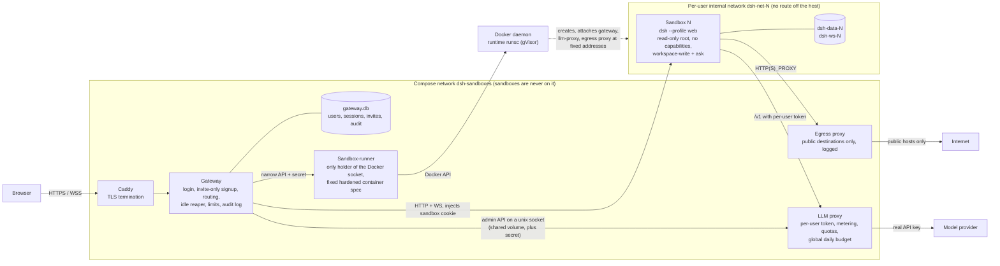

# Serving DeepSeek Harness as a public multi-user web app

## Context

`dsh --profile web` already serves a full browser UI (`apps/web`, `packages/client/*`) over HTTP `/api` plus WebSocket `/api/remote.mux`. It is single-owner: one launch token, one shared owner Peer, one `$DSH_HOME`, and no tenancy. Sandboxing covers file effects only and shares the host kernel. `SAFETY.md` says it is not for untrusted workloads, and the container execution backend does not exist (`packages/ptc-runtime` notes it as undecided; E2B was removed, `packages/host/apiproxy` is stale build output only).

Chosen: public/untrusted users, operator-owned shared DeepSeek key.

## Recommended architecture: control plane + one disposable sandbox per user

Do not make one `dsh` process multi-tenant. Treat each `dsh --profile web` as a single-owner appliance and put isolation around it.

```
Browser ─TLS─> Gateway/control plane ──> per-user sandbox (microVM/gVisor container)
               (login, sessions,          dsh --profile web, own $DSH_HOME + workspace
                quotas, routing)          egress-restricted, CPU/mem/disk/time limits
                       │                              │
                       └── LLM proxy (holds real key, per-user metering) <── dummy key
```

1. **Control plane (new service, outside `packages/`)** – OIDC/email login, user DB, per-user sandbox lifecycle (create, resume on a persistent volume, idle-stop), and a reverse proxy to the user's sandbox. The proxy follows `docs/user/guide/public-deployments.md`: preserve `Host`, forward WebSocket upgrades, strip the mount prefix, rewrite cookie `Path`. Launch each sandbox with `--host <ip> --public-url --trusted-host`. Sandboxes are only reachable from the gateway, which injects the launch token.
2. **Sandbox runtime** – Firecracker/Kata or gVisor, one per user, with a persistent volume for `$DSH_HOME` and workspace. Add per-sandbox CPU, memory, disk, pid and wall-clock limits, plus default-deny egress (allowlist the LLM proxy; decide on web fetch). Ship the `workspace-write` + `ask` preset by default and hide `danger-full-access` and the host directory picker (`packages/host/directory-picker-browse`).
3. **LLM proxy** – the sandbox gets `DEEPSEEK_BASE_URL` pointing at the proxy and a per-user token as `DEEPSEEK_API_KEY`. The proxy holds the real key, meters tokens per user, enforces quotas and rate limits. The real key never enters the sandbox (the agent can read the sandbox's environment and credential files).
4. **Image** – Dockerfile/rootfs with Node ^22.19, built `dsh`, and the web profile. The repo has no container assets, so this is new.

## Architecture diagram

Components as built through phase 4. Details and decisions: [plan-phase-4.md](plan-phase-4.md).



Request flow:

1. The browser signs in at the gateway (an invite code is needed to sign up unless open signup is on) and receives only the `gw_session` cookie.
2. The gateway checks capacity, then asks the runner to create or start the user's container. The runner builds the container spec itself, creates the user's internal network, and attaches the gateway, llm-proxy and egress proxy to it. The gateway reads the launch token from the container's logs, exchanges it for the sandbox auth cookie, and injects it on every proxied HTTP request and WebSocket upgrade. The browser never holds the sandbox cookie.
3. The sandbox calls the model with a per-user token. The proxy swaps in the real key, counts tokens, and rejects calls over the user's quota or the global daily budget. The real key never enters a sandbox.
4. Web access goes through the egress proxy, which resolves each destination itself and refuses private, loopback, link-local and metadata addresses. The agent's shell is confined to `/workspace` by bubblewrap (gVisor allows the user namespaces it needs).
5. The gateway stops sandboxes that are idle, past the run-time limit or over the disk limit; the named volumes keep `$DSH_HOME` and the workspace. Every sign-in, sign-up and sandbox lifecycle event is written to the audit log.

## Where harness changes may be needed

Only if the above proves insufficient. Read first: `docs/architecture.md` (Application launch), `docs/subsystems/{web-server,sandbox,persistence,credentials}.md`, `packages/host/authentication-token/README.md`.
- A pluggable auth provider via `ctx.connection.authentication.register()` if the gateway cannot inject the launch token cleanly.
- A container/microVM backend behind `ctx.fs` / `ctx.subprocess` only if you later want one shared host process instead of one VM per user (a large change; follows capability-seam rules in CLAUDE.md).
- Any harness change needs an Agent Note, docs, and snapshots per CLAUDE.md. Launch must go through `dsh` (no custom Node entry points).

## Phases

1. Prototype: Dockerfile + one container running `dsh --profile web` behind Caddy/nginx with TLS; confirm WebSocket and cookie behavior. **Done.**
2. Control plane: auth, user→sandbox mapping, spawn/stop, persistent volumes. **Done.**
3. LLM proxy with per-user metering and quotas. **Done.**
4. Hardening: gVisor, egress policy, resource limits, audit logging, abuse controls, backups, pinned builds, CI. **Done** for a Linux host with gVisor; see [plan-phase-4.md](plan-phase-4.md) for what was verified and what is left. A microVM backend (Kata or Firecracker) and a formal sandbox-escape review were not done.
5. Friendlier experience: first-run polish, clear limits and states, a usable toolbox, work that keeps running. Scope chosen, not started; see [plan-phase-5.md](plan-phase-5.md).

## Verification

Covered by `tests/run.sh` (see [../tests/README.md](../tests/README.md)); results for phase 4 are in [plan-phase-4.md](plan-phase-4.md).

- Two users log in simultaneously; neither can see the other's sessions, files, or processes, including through the web path to internal addresses. *(phase 2 and 4 suites)*
- The real API key is absent from the sandbox filesystem and environment, and quota exhaustion stops model calls. *(phase 3)*
- Hostile behaviour (fork bomb, large writes, CPU spin, memory hog, network scan) stays inside the limits. *(phase 4)*
- Reconnect/resume a session after sandbox idle-stop. *(phase 2)*
- Not done: a soak test of WebSocket reconnect through the gateway, and a browser-level check of the locked-down UI.
